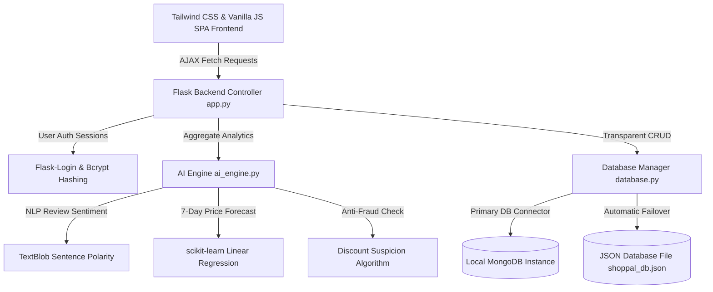

# 🛒 Shoppal India - AI-Powered Price Comparison Platform

**Shoppal India** is a premium, state-of-the-art e-commerce aggregator and smart price intelligence platform. Built with Python 3.10+, Flask, MongoDB (PyMongo), Tailwind CSS, and standard machine learning libraries (**scikit-learn** and **TextBlob**), it offers consumers real-time price comparisons across major marketplaces (Amazon, Flipkart, Nykaa, Myntra), NLP-powered customer review analysis, 7-day predictive price trends, and fake discount detection audits.

---

## ⚡ Key Highlights & Architecture



### 1. **AI/ML Engine (`ai_engine.py`)**
- **Linear Regression Price Forecast (scikit-learn)**: Fits the past 30 days of historical vendor prices and projects coordinates for the next 7 days, flagging buying recommendations:
  - `⚠️ Buy before price hike` (Positive slope threshold > 1.5%)
  - `✅ Price drop predicted` (Negative slope threshold < -1.5%)
  - `✅ Price stable` (Fluctuating slope within +/- 1.5%)
- **NLP Sentiment Breakdown (TextBlob)**: Computes review sentence polarities (-1.0 to +1.0) and translates them into an intuitive positive/neutral/negative percentage layout with an automated prose summary.
- **Fake Discount Audit**: Analyzes market prices and standard deviations to assess whether claimed retailer discount rates are genuine or inflated MSRP theater.

### 2. **Bulletproof Database Failover (`database.py`)**
- Establishes a local MongoDB client (`pymongo.MongoClient`) on port `27017` with a rapid connection timeout.
- If MongoDB is inactive or unreachable, the database layer automatically fails over to a local, file-based JSON database (`shoppal_db.json`), ensuring **100% server uptime and structural robustness** out of the box.

### 3. **Seamless REST Authentication & Session Security (`app.py`)**
- Synchronizes user logins and registrations via `Flask-Login` and secure standard salt hashing using `bcrypt`.
- Integrates a custom `@login_manager.unauthorized_handler` that returns clean HTTP `401 Unauthorized` JSON responses rather than standard web redirects, conforming perfectly to modern Single-Page Application (SPA) REST API architectures.

---

## 🚀 Technical Stack Summary

| Layer | Technology | Purpose |
| :--- | :--- | :--- |
| **Backend Framework** | Python 3.10+ & Flask | Core web server and REST API controller |
| **Database** | MongoDB (PyMongo) | Flexible document store for products, reviews, and user watchlists |
| **Database Failover** | Local JSON File System | Clean file-based database for offline sandbox isolation |
| **Web SPA Frontend** | HTML5, Tailwind CSS, Vanilla JS | Stunning, responsive glassmorphic interfaces with zero compilation tools |
| **Data Visualization** | Chart.js (via CDN) | Beautiful, responsive price line charts with dotted AI prediction overlays |
| **NLP Analysis** | TextBlob (NLTK) | Live reviews text sentence polarity calculations |
| **Price Predictions** | scikit-learn (scipy/numpy) | Linear regression model fits for 7-day e-commerce forecasts |
| **User Authentication** | Flask-Login & Bcrypt | Session management, password encryption, and API guards |
| **Automation Tests** | unittest & pytest | Continuous integration verifying all API paths and AI computations |

---

## 📦 Directory Structure

```text
c:\Projects\Shoppal\
├── requirements.txt         # Core environment dependencies
├── app.py                   # Main Flask server controller
├── database.py              # PyMongo manager with automatic JSON failover
├── ai_engine.py             # TextBlob NLP and scikit-learn regressions
├── templates/
│   └── index.html           # Glassmorphic Tailwind frontend UI
├── static/
│   └── js/
│       └── app.js           # Core SPA router, Chart.js, AJAX auth & watchlist
└── tests/
    ├── test_ai.py           # ML calculations and prediction unit tests
    └── test_app.py          # API client endpoints integration tests
```

---

## 🛠️ Installation & Execution

### 1. Set Up Environment
Ensure Python 3.10+ is installed on your environment. In your terminal:
```powershell
# Activate your virtual environment
c:\Projects\.venv\Scripts\Activate.ps1

# Navigate to project CWD
cd c:\Projects\Shoppal

# Install dependencies (Flask, PyMongo, scikit-learn, TextBlob, etc.)
pip install -r requirements.txt
```

### 2. Start local MongoDB (Optional)
If you have MongoDB installed, make sure it is running on standard port `27017`.
> **Note**: If MongoDB is not running, the application will automatically fall back to `shoppal_db.json` file storage seamlessly!

### 3. Launch Server
```powershell
python app.py
```
Open [http://127.0.0.1:5000](http://127.0.0.1:5000) in your web browser.

---

## 🧪 Running Automation Tests

A comprehensive suite of **16 automated unit and integration tests** verifies the backend's core APIs and machine learning algorithms:

```powershell
python -m unittest discover -s tests
```

### Tests Covered:
- **`tests/test_ai.py`**:
  - Empty review, positive, and negative TextBlob polarity checks.
  - Stable, rising (Buy Now!), and dropping (Wait!) regression slope forecasts.
  - Genuine and suspicious discount index audits.
- **`tests/test_app.py`**:
  - `/api/system-status` health checks.
  - Category catalog listings and text searches.
  - Detailed product data aggregating AI predictions, NLP percentages, and similar recommenders.
  - Full user auth lifecycle: signup $\rightarrow$ login $\rightarrow$ adding items to favorites watchlist $\rightarrow$ logout.

---

## 📺 User Interaction walkthrough & Demo

A high-fidelity browser recording of the complete application lifecycle (covering category switching, search console testing, product detailed analysis modals, registration, and watchlists) has been successfully recorded and saved:

🎥 **Interactive WebP Demo**: [shoppal_india_demo.webp](file:///C:/Users/raghu/.gemini/antigravity/brain/9fb65ef7-08c2-46f7-87f0-92bb5bafbb9f/shoppal_india_demo_1779283527898.webp)

### Step-by-Step UI Verification:
1. **Interactive Category Pills**: Tapping pills like **Skincare** immediately filters catalog products down dynamically.
2. **AI Price Details Modal**: Clicking on a product card slides open a detailed overview:
   - **Tab 1**: Visualizes price history across major Indian merchants, overlaying a dotted, dashed **AI 7-DAY FORECAST** line.
   - **Tab 2**: Displays NLP reviews sentiment ratios (Progress bars) and the Fake Discount Audit score index.
   - **Tab 3**: Lists similar alternatives sorted by cheapest value.
3. **Register/Login Session Hook**: Tapping **Sign Up** opens a secure modal form. Registration creates a session instantly, displaying `"Hello, John Doe!"` and enabling heart favorites icons.
4. **Interactive watchlist**: Favorited items instantly glow with animated rose-pink icons and sync directly to the user's secure **Favorites** console.
