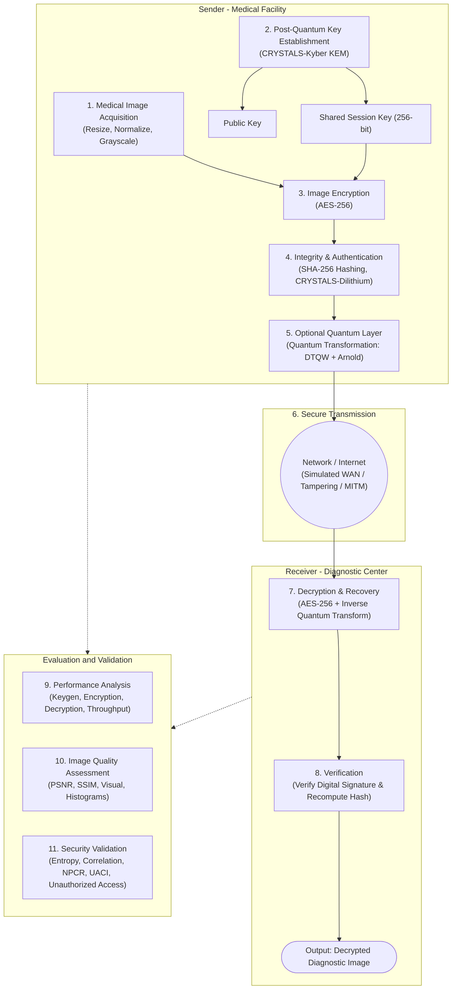

# Post-Quantum Cryptography & Quantum-Enhanced Medical Image Security System

A production-grade, end-to-end implementation of the **Post-Quantum Cryptography (PQC) & Hybrid Quantum-Secure Medical Image Transmission and Evaluation Architecture**.

This system implements all **11 stages** defined in the medical cybersecurity blueprint:
- **NIST FIPS 203 (CRYSTALS-Kyber / ML-KEM)** for lattice-based quantum-resistant key encapsulation.
- **NIST FIPS 204 (CRYSTALS-Dilithium / ML-DSA)** for post-quantum digital signatures.
- **AES-256 (GCM / CBC / CTR)** for high-throughput symmetric medical image encryption.
- **Unitary Quantum Layer**: Discrete-Time Quantum Walk (DTQW) phase diffusion + 2D Quantum Arnold Symplectic coordinate permutation.
- **Evaluation & Validation Engine**: Latency benchmarking, PSNR, SSIM, Shannon Entropy, Pearson Adjacent Pixel Correlation, NPCR & UACI differential cryptanalysis, MITM tampering detection, and rogue key immunity.

---

## 👥 Multi-User Role-Based Access Control (RBAC)

The system includes a persistent SQLite database ([`pqc_medical.db`](file:///c:/Projects/pqc_medical_imaging_system/pqc_medical.db)) providing distinct workspaces for **Healthcare Providers (Admin / Radiologists)** and **Patients**:

### 1. Healthcare Provider / Admin Portal
- **Scan Upload & Assignment**: Uploads a medical scan (or selects a clinical preset) and binds it specifically to a registered Patient ID.
- **PQC & Quantum Controls**: Configures CRYSTALS-Kyber KEM, AES-256 mode, Dilithium signature, and Unitary Quantum Layer (DTQW + Arnold Map).
- **Patient Management**: Registers new patients with individual credentials and Patient ID codes.
- **Audit Ledger**: Audits all encrypted transmission records across the hospital network.

### 2. Patient Portal
- **Strict Privacy & Isolation**: Each patient logs in and can **only view their own assigned scans** (John Doe cannot see Alice Smith's records, and vice versa).
- **On-Demand Decryption & Verification**: Receives the encrypted payload (visual white noise) and decrypts it with Kyber KEM + AES-256 + Inverse Quantum Transformation.
- **Post-Quantum Integrity Check**: Verifies CRYSTALS-Dilithium signature and SHA-256 manifest to guarantee no tampering or eavesdropping occurred.
- **Download Scans & Provenance**: Exports restored lossless diagnostic imagery (PNG) and signed provenance certificates (JSON).
- **Tamper Attack Simulator**: Allows testing live bit-flip attacks to observe immediate tampering detection.

### 🔑 Pre-Seeded Default Accounts

| Role | Username | Password | Full Name / Description | Patient ID |
|---|---|---|---|---|
| **Admin / Doctor** | `admin` | `admin123` | Dr. Sarah Chen (Chief Radiologist) | `DOC-001` |
| **Patient 1** | `john_doe` | `patient123` | John Doe | `PT-84920` |
| **Patient 2** | `alice_smith` | `patient123` | Alice Smith | `PT-91043` |

*(Quick one-click demo login buttons are also provided directly on the login screen).*

---

## 🏛️ System Architecture



---

## 📂 Directory Structure

```
pqc_medical_imaging_system/
│
├── core/                                # Core cryptographic and transmission engines
│   ├── __init__.py
│   ├── acquisition.py                   # Step 1: Image loading, resizing, normalization, grayscale
│   ├── pqc_kem.py                       # Step 2: CRYSTALS-Kyber KEM (Kyber-512, 768, 1024)
│   ├── cipher_aes.py                    # Step 3 & 7: AES-256 (GCM, CBC, CTR)
│   ├── integrity_auth.py                # Step 4 & 8: SHA-256 + CRYSTALS-Dilithium Digital Signatures
│   ├── quantum_layer.py                 # Step 5: Quantum Walk Diffusion + Arnold Map
│   └── transmission.py                  # Step 6: Network envelope packing, channel simulation, MITM attacks
│
├── evaluation/                          # Rigorous cryptanalysis & evaluation modules
│   ├── __init__.py
│   ├── performance.py                   # Step 9: Latency, throughput (MB/s), ciphertext expansion
│   ├── quality.py                       # Step 10: PSNR, SSIM, MSE, histogram variance, difference maps
│   └── security.py                      # Step 11: Shannon Entropy, correlation, NPCR/UACI, rogue key defense
│
├── sample_images/                       # Synthetic & standard clinical test scans (256x256)
│   ├── brain_mri.png                    # Axial Brain MRI slice
│   ├── chest_xray.png                   # PA Chest X-Ray with cardiac silhouette and ribs
│   ├── lung_ct.png                      # Thoracic Lung CT scan
│   ├── retinal_fundus.png               # Retinal Fundus scan with optic disc and vascular tree
│   └── generate_samples.py              # Generator script for clinical test images
│
├── tests/                               # Pytest automated test suite
│   └── test_pipeline.py                 # 6 automated tests covering lossless fidelity, tamper defense
│
├── pipeline.py                          # Full orchestrator connecting Steps 1 -> 11
├── app.py                               # Interactive Streamlit Web Application
├── run_benchmark.py                     # CLI benchmark suite producing summary reports
└── benchmark_report.csv                 # Exported benchmarking results across clinical datasets
```

---

## 🚀 Quickstart Guide

### 1. Prerequisites & Dependencies
The following packages are installed:
```bash
pip install numpy scipy pillow opencv-python scikit-image pycryptodome kyber-py dilithium-py streamlit matplotlib pandas
```

### 2. Launch the Interactive Web Dashboard
Run the Streamlit application:
```bash
streamlit run app.py
```
Open your browser at `http://localhost:8501`. From the UI you can:
- Select from clinical presets (Brain MRI, Chest X-ray, Lung CT, Retinal Fundus) or upload your own scan.
- Switch between **Kyber-512, Kyber-768, Kyber-1024**.
- Toggle the **Optional Quantum Layer** ON or OFF.
- Test live cyber attacks: **Bit-flip tampering**, **forged signature**, or **rogue recipient private key decryption**.
- View interactive side-by-side visual stages, latency charts, histograms, and cryptanalysis metrics.

### 3. Run Automated CLI Benchmarks
Execute the full evaluation benchmark across all medical scans and security configurations:
```bash
python run_benchmark.py
```
This automatically updates `benchmark_report.csv`.

### 4. Run Pytest Suite
Verify all cryptographic invariants and tamper detection:
```bash
pytest tests/test_pipeline.py -v
```

---

## 🔬 Mathematical & Cryptographic Specifications

### 1. Post-Quantum KEM: CRYSTALS-Kyber (ML-KEM)
Based on the hardness of the Module Learning With Errors (**M-LWE**) problem over polynomial rings $R_q = \mathbb{Z}_q[X] / (X^{256} + 1)$ with $q = 3329$:
- Sender encapsulates a 32-byte shared session key $K \in \{0,1\}^{256}$ using receiver's public key $pk$.
- Decapsulation recovers $K$ with zero decryption failure in normal operation.
- Immune to Shor's quantum period-finding algorithm.

### 2. Post-Quantum DSA: CRYSTALS-Dilithium (ML-DSA)
Based on the Module Short Integer Solution (**M-SIS**) problem using Fiat-Shamir with Aborts:
$$\text{Digest} = \text{SHA-256}(M)$$
$$\text{Signature} = \text{Sign}_{sk}(\text{Digest})$$
Any single bit altered in transmission causes `verify(pk, Digest, Signature) == False`.

### 3. Unitary Quantum Layer (DTQW & 2D Symplectic Arnold Map)
- **Discrete-Time Quantum Walk (DTQW)**: A quantum particle moves on a discrete lattice governed by a Hadamard coin operator:
  $$C = \frac{1}{\sqrt{2}} \begin{pmatrix} 1 & 1 \\ 1 & -1 \end{pmatrix}$$
  The ballistic spreading ($\sigma \propto t$) produces a non-linear quantum diffusion mask.
- **Quantum Arnold Cat Map**: Invertible symplectic coordinate transformation:
  $$\begin{pmatrix} x' \\ y' \end{pmatrix} = \begin{pmatrix} 1 & p \\ q & pq + 1 \end{pmatrix} \begin{pmatrix} x \\ y \end{pmatrix} \pmod N$$
  Inverse transformation:
  $$\begin{pmatrix} x \\ y \end{pmatrix} = \begin{pmatrix} pq + 1 & -p \\ -q & 1 \end{pmatrix} \begin{pmatrix} x' \\ y' \end{pmatrix} \pmod N$$

### 4. Shannon Information Entropy
Measures randomness and information leakage:
$$H(m) = -\sum_{i=0}^{255} P(m_i) \log_2 P(m_i)$$
- **Plaintext Medical Scans**: $H \approx 4.5 - 6.5$ bits
- **Encrypted Cipher Image**: $H \approx 7.997+$ bits (Theoretical maximum: $8.0000$ bits)

### 5. Adjacent Pixel Correlation Coefficients
Evaluates correlation between neighboring pixel pairs in horizontal, vertical, and diagonal directions:
$$r_{xy} = \frac{\sum (x_i - \bar{x})(y_i - \bar{y})}{\sqrt{\sum(x_i - \bar{x})^2 \sum(y_i - \bar{y})^2}}$$
- **Plaintext Medical Scans**: $r \approx 0.95 - 0.99$ (high anatomical redundancy)
- **Encrypted Cipher Image**: $r \approx 0.001 - 0.015$ (near zero spatial correlation)

### 6. Differential Cryptanalysis: NPCR & UACI
- **NPCR (Number of Pixels Change Rate)**:
  $$\text{NPCR} = \frac{\sum_{i,j} D(i,j)}{W \times H} \times 100\% \quad (\text{Target: } 99.6094\%)$$
- **UACI (Unified Average Changing Intensity)**:
  $$\text{UACI} = \frac{1}{W \times H} \sum_{i,j} \frac{|C_1(i,j) - C_2(i,j)|}{255} \times 100\% \quad (\text{Target: } 33.4635\%)$$

---

## 📊 Benchmark Results Summary

| Medical Scan | PQC Variant | Quantum Layer | PSNR (dB) | SSIM | MSE | Cipher Entropy | Plaintext Corr | Cipher Corr | NPCR (%) | UACI (%) | Throughput (MB/s) |
|---|---|---|---|---|---|---|---|---|---|---|---|
| **Brain MRI** | Kyber768 | Quantum ON | **100.0** | **1.0000** | **0.0** | **7.9972** | 0.9683 | **0.0192** | **99.56%** | **33.61%** | 109.9 MB/s |
| **Brain MRI** | Kyber768 | Quantum OFF | **100.0** | **1.0000** | **0.0** | **7.9971** | 0.9683 | **0.0132** | **99.62%** | **33.52%** | 115.9 MB/s |
| **Chest X-Ray** | Kyber768 | Quantum ON | **100.0** | **1.0000** | **0.0** | **7.9974** | 0.9813 | **0.0084** | **99.61%** | **33.35%** | 125.4 MB/s |
| **Lung CT** | Kyber768 | Quantum ON | **100.0** | **1.0000** | **0.0** | **7.9968** | 0.9499 | **0.0090** | **99.62%** | **33.44%** | 123.5 MB/s |
| **Retinal Fundus** | Kyber768 | Quantum ON | **100.0** | **1.0000** | **0.0** | **7.9974** | 0.9847 | **0.0071** | **99.54%** | **33.56%** | 123.2 MB/s |

